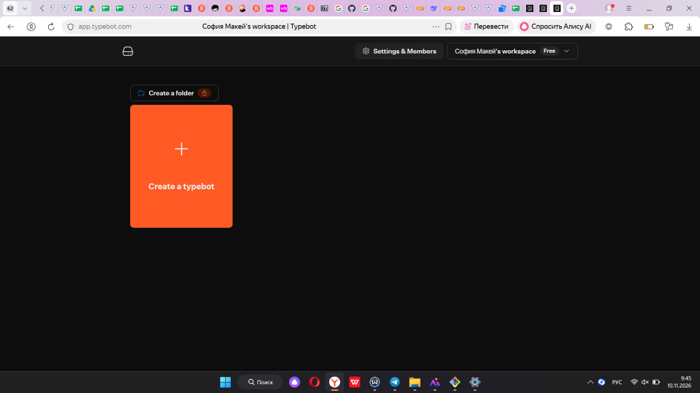
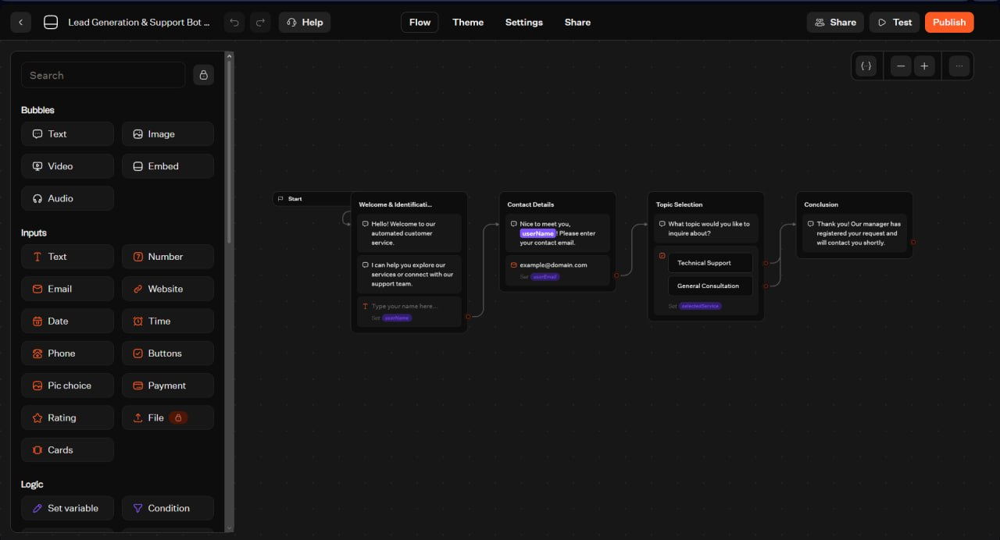
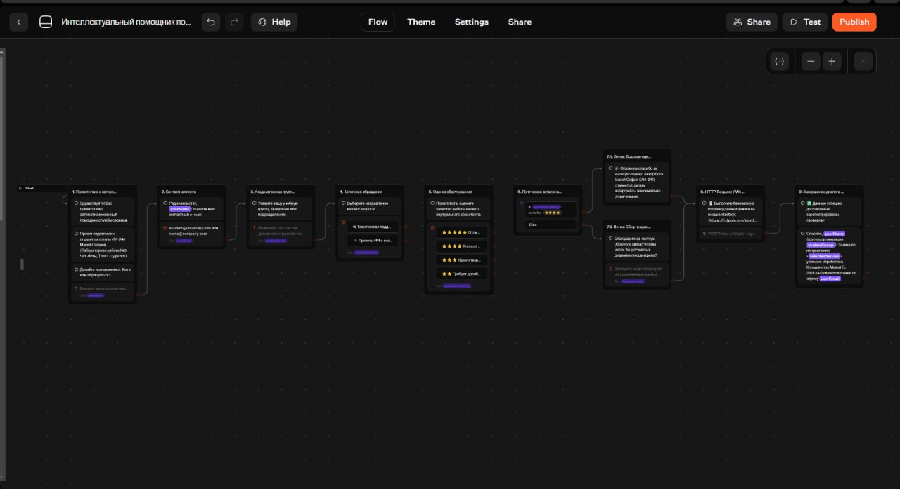
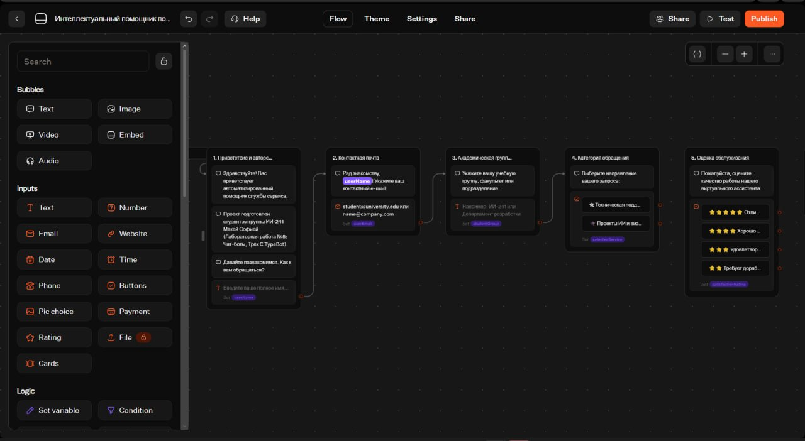
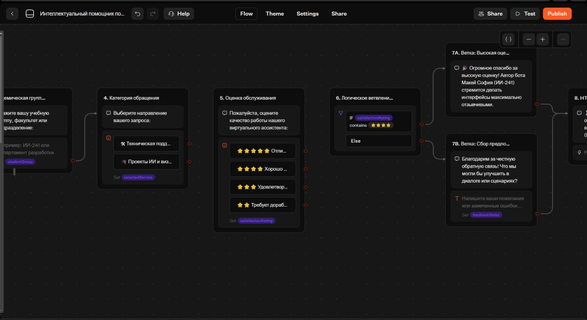
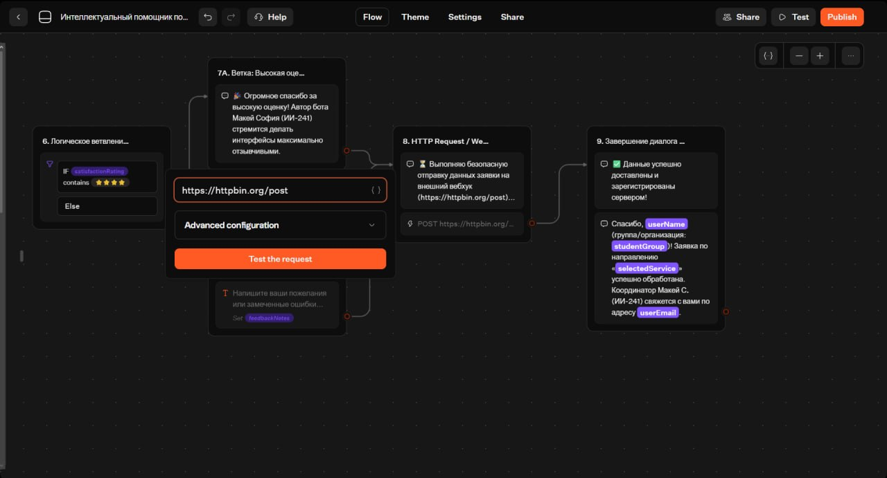
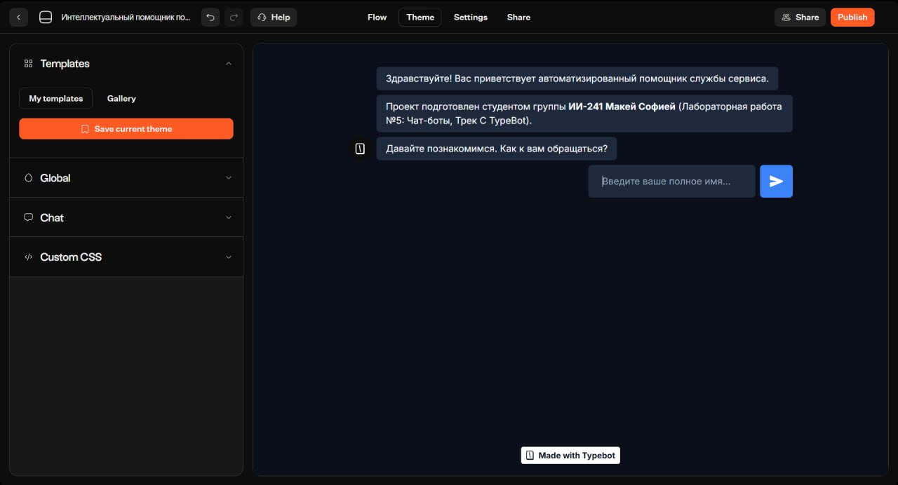
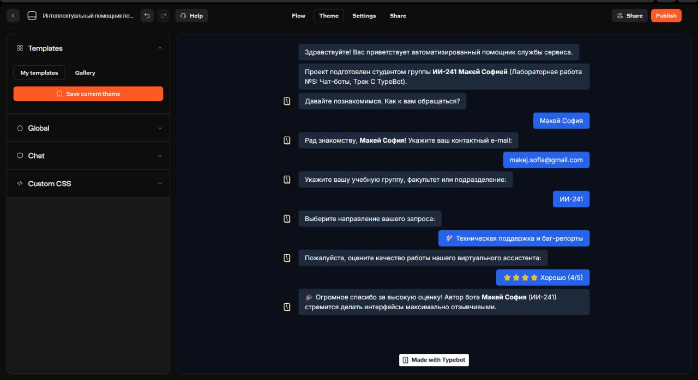

# Лабораторная работа №5. Чат-боты

Студентка: Макей София  
Группа: ИИ-241  
Выбранный трек: Трек C. TypeBot  
Ссылка на бота: [https://typebot.co/241-ujam1wm](https://typebot.co/241-ujam1wm)

---

## 1. Краткое описание выбранного трека и внесённых изменений
Для выполнения работы выбрана платформа TypeBot Cloud (Трек C). В рабочем пространстве был выбран базовый шаблон *Lead Generation & Support Bot*, после чего выполнены все шаги по заданию:

1. Русификация шаблона: переведены на русский язык все текстовые сообщения, кнопки выбора, описания, сообщения об ошибках ввода почты и плейсхолдеры полей. Проверена сохранность логики переходов и переменных.
2. Добавлены новые блоки и шаги:
   - блок запроса учебной группы / подразделения (3. Академическая группа);
   - блок оценки качества работы ассистента с кнопками от 2 до 5 звёзд (5. Оценка обслуживания);
   - дополнительные блоки обратной связи (7A. Ветка: Высокая оценка и 7B. Ветка: Сбор предложений).
3. **Добавлены переменные (Variables):** userName, userEmail, studentGroup, selectedService, satisfactionRating, feedbackNotes.
4. **Добавлено условие (Condition):** в блоке 6. Логическое ветвление настроена проверка переменной satisfactionRating (оператор Contains значение ⭐⭐⭐⭐). При высокой оценке (4–5 звёзд) бот переходит к блоку благодарности 7A, иначе (Else) — запрашивает пожелания в блоке 7B.
5. **Добавлена интеграция (HTTP Request / Webhook):** в блоке 8 настроен POST-запрос на тестовый сервер https://httpbin.org/post для передачи собранных ответов пользователя.
6. **Изменена тема и брендинг (Theme):** настроена тёмная цветовая схема оформления чата.

---

## 2. Ссылка на бота и экспорт сценария
- Опубликованный бот (Web-ссылка): [https://typebot.co/241-ujam1wm](https://typebot.co/241-ujam1wm)
- Экспорт исходного шаблона: [lab5/exports/flow-01-template.json](../exports/flow-01-template.json)
- Экспорт готового сценария: [lab5/exports/flow-01-Makej.json](../exports/flow-01-Makej.json)

---

## 3. Освоенные блоки, ноды и элементы
- Text (Bubbles): текстовые блоки для вывода сообщений бота с подстановкой значений переменных ({{userName}}, {{studentGroup}}, {{selectedService}}, {{userEmail}}).
- Text Input: поля ввода текстовых данных (ФИО, учебная группа, предложения по улучшению) с записью результата в переменные.
- Email Input: поле ввода email с автоматической валидацией формата адреса.
- Buttons (Choice Input): кнопки выбора категории обращения и оценки качества работы.
- Variables: пользовательские переменные для хранения введённых данных и их использования в тексте, условиях и запросах.
- Condition: логический блок ветвления сценария по значению переменной.
- HTTP Request / Webhook: блок интеграции для отправки HTTP POST-запросов на внешний URL.

---

## 4. Примеры использованных AI-промптов
[12.11.2026 9:18] Perhat: 1. "Предложи вежливые формулировки на русском языке для приветствия, запроса контактных данных и завершения диалога в чат-боте технической поддержки."
2. "Какой бесплатный публичный эндпоинт можно использовать для тестирования отправки POST-запросов из блока Webhook в конструкторе чат-ботов?"
3. "Подбери сочетающиеся HEX-коды цветов в темных тонах для настройки фона, сообщений бота и кнопок пользователя в веб-чате."

---

## 5. Скриншоты выполнения работы

### 5.1. Рабочее пространство (Workspace) в TypeBot

### 5.2. Шаблон «До» русификации и изменений

### 5.3. Общий вид сценария «После» русификации и доработки

### 5.4. Русифицированные блоки и настройки переменных (блоки 1–5)

### 5.5. Настройка условия Condition и ветвления (блоки 6, 7A, 7B)

### 5.6. Настройка интеграции HTTP Request / Webhook (блок 8)

### 5.7. Настройка темы оформления (Theme)

### 5.8. Результат работы опубликованного чат-бота

---

## 6. Выводы
В ходе лабораторной работы я изучила платформу визуального проектирования чат-ботов TypeBot. На практике освоила перевод и адаптацию готового шаблона, создание новых шагов диалога, работу с переменными, настройку логического ветвления через блок Condition, подключение внешней интеграции с помощью HTTP Request / Webhook, а также изменение темы оформления и публикацию бота по веб-ссылке.
