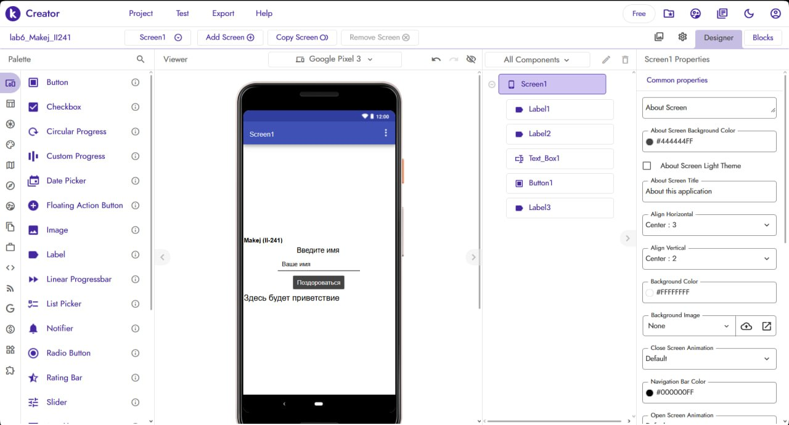
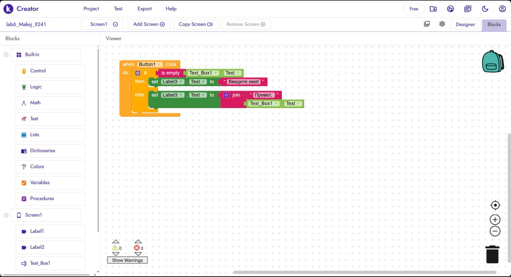

# Лабораторная работа №6. Kodular

Студентка: Макей София  
Группа: ИИ-241  
Проект: lab6_Makej_II241  
Экспорт проекта (.aia): [lab6/exports/lab6-Makej.aia](../exports/lab6-Makej.aia)
Ну неплохо, не плохо, я думал будет хуже
---

## 1. Краткое описание приложения
В рамках лабораторной работы на платформе визуального программирования Kodular Creator создано мобильное приложение «Приветствие» (lab6_Makej_II241).

На экране Screen1 расположены следующие элементы:
- Label1 — фамилия автора на английском языке: `Makej (II-241)`;
- Label2 — текстовый заголовок: `Введите имя`;
- Text_Box1 — поле для ввода имени (подсказка Hint = Ваше имя);
- Button1 — кнопка `Поздороваться`;
- Label3 — текстовое поле вывода приветствия (исходный текст: `Здесь будет приветствие`).

Логика работы: при нажатии на кнопку Button1 блок условия if / then / else проверяет поле Text_Box1.Text через блок is empty. Если имя не введено, в Label3 выводится текст «Введите имя!», иначе через блок join склеивается и выводится фраза «Привет, <имя>!».

---

## 2. Ссылка на проект и экспорт
- Архив проекта (.aia): [lab6/exports/lab6-Makej.aia](../exports/lab6-Makej.aia)

---

## 3. Освоенные компоненты и блоки
- Визуальные компоненты (`Designer`): Screen1 (выравнивание по центру), Label, Text Box (свойство Hint), Button.
- Блоки логики (`Blocks`): событие нажатия when Button1.Click, условный оператор if / then / else, проверка пустой строки is empty, соединение строк join, чтение Text_Box1.Text и изменение текста set Label3.Text to.

---

## 4. Примеры использованных AI-промптов
1. "Как в Kodular проверить, пустое ли текстовое поле TextBox при нажатии на кнопку?"
2. "Как работает блок соединения строк join в Kodular для вывода имени пользователя?"
3. "Какие ограничения действуют на бесплатном тарифе Kodular Free?"

---

## 5. Скриншоты выполнения работы

### 5.1. Экран дизайнера (Screen1) с фамилией автора

### 5.2. Блоки логики приложения (Blocks)

---

## 6. Ограничения бесплатного тарифа Kodular
На бесплатном тарифе Kodular Free действуют следующие лимиты:
- максимум 10 проектов на аккаунте;
- до 10 МБ медиафайлов (ассетов) внутри проекта;
- не более 5 внешних расширений (`Extensions`) на один проект.

---

## 7. Выводы
В ходе работы я изучила среду визуальной разработки мобильных приложений Kodular Creator, научилась размещать и настраивать компоненты пользовательского интерфейса на экране, создавать логику обработки событий с помощью условных и текстовых блоков, а также экспортировать готовый проект в формат .aia.
